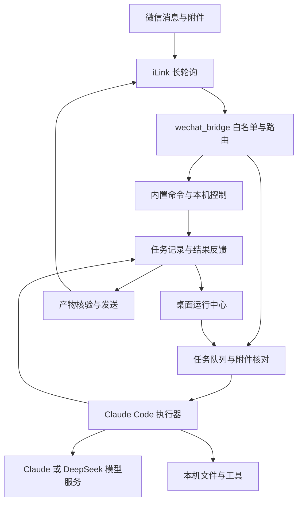

# 架构与模块导航

本项目采用 Python 后台加 Windows WinForms 桌面界面。运行模块保留根目录布局，测试和说明文档独立归档，启动脚本从自身位置定位配置和程序。

## 消息和任务如何流转

轮询线程接收和分发消息，长任务进入队列；内置命令按各自能力执行。模型回复中明确声明的产物经过有限文件检查后登记，发送结果单独记录。任务状态、文件有效性和微信发送回执分别代表不同层面的证据。

## 代码职责

| 层次 | 主要文件 | 职责 |
| --- | --- | --- |
| 程序入口 | `wechat_bridge.py`、`start_wechat.ps1`、`微信助手.bat` | 登录、配置检查、轮询与桌面启动 |
| 微信传输 | `ilink_client.py`、`aes128.py`、`file_transfer.py`、`download_transfer.py` | iLink API、媒体加解密、上传下载 |
| 路由与命令 | `bridge_admin.py`、`bridge_chat.py`、`bridge_inbox.py`、其他 `bridge_*.py` | 白名单后的命令分发、附件、模板、提醒及响应 |
| 模型执行 | `claude_runner.py`、`deepseek_runner.py`、`claude_api_runner.py` | CLI 子进程、模型环境、结果与取消 |
| 配置与运行 | `bridge_config.py`、`bridge_runtime.py`、`backend_profile.py`、`key_vault.py` | 配置、状态、后端设置与 Windows 凭据保护 |
| 任务与数据 | `task_control.py`、`task_journal.py`、`task_artifacts.py`、`task_templates.py`、`task_revisions.py` | 队列、SQLite 记录、产物、模板与后续修改 |
| 输入与检查 | `attachment_batches.py`、`template_result_checks.py`、`snapshot_lifecycle.py` | 附件批次、有限结果检查与副本生命周期 |
| 桌面工作流 | `desktop_*.py`、`workflow_desktop.py`、`template_desktop.py` | 桌面任务、文件、模板、定时和历史读取 |
| 桌面界面 | `tray_app.ps1`、`workflow_window.ps1`、`task_history.ps1`、`*_ui.ps1`、`tray_theme.cs` | 运行中心、弹窗、布局和主题 |
| 进程启动 | `process_launcher.ps1`、`process_bootstrap.ps1`、`independent_process.cs` | 桌面宿主与后台子进程隔离 |
| 本机能力 | `app_launcher.py`、`screen_control.py`、`volume.py`、`brightness.py`、`power.py`、`wemeet.py`、`remind.py` | 应用、屏幕、媒体、电源、会议与提醒 |
| 开发工具 | `tools/verify.py`、`selftest.py`、`tests/` | 套件登记、离线模拟和回归验证 |

## 本机数据

| 位置 | 内容 | 是否提交 Git |
| --- | --- | --- |
| `config.example.json`、`BOT_MEMORY.example.md` | 通用模板 | 是 |
| `config.json`、`BOT_MEMORY.md` | 登录、用户配置、固定记忆 | 否 |
| `.runtime/tasks.sqlite` | 任务记录、结果及恢复信息 | 否 |
| `.runtime/` | 状态、控制请求、模板、副本、后端数据和测试报告 | 否 |
| `sessions.json`、`inbox.json`、`meetings.json`、`reminders.json` | 会话、收件与计划索引 | 否 |
| `app_targets.json`、`app_preferences.json` | 本机应用索引与偏好 | 否 |
| `bridge.log*`、`bridge.pid`、`shots/` | 日志、进程信息和截图 | 否 |
| 配置的 `inbox.dir` 和工作目录 | 输入附件和生成结果 | 不属于仓库内容 |

路径以当前配置与实现为准。任务正文、模型回复和附件可能包含私人资料，备份时按本机工作数据保管。模型调用会把必要的任务内容发到所选服务。

## 维护边界

- 所有消息必须经过既有用户校验与路由，新增界面操作也应复用任务控制和记录逻辑。
- 文件处理复用允许目录、大小、凭据文件排除、指纹和快照检查。
- 任务停止是协作取消及进程树终止，不提供事务回滚；重启不自动重跑已开始任务。
- 结果基础检查不证明语义正确；发送成功回执不证明手机已下载或查看。
- 测试使用临时目录和模拟外部系统；Windows 进程隔离套件需显式请求。

进一步的测试入口和提交方式见[贡献指南](../CONTRIBUTING.md)。
